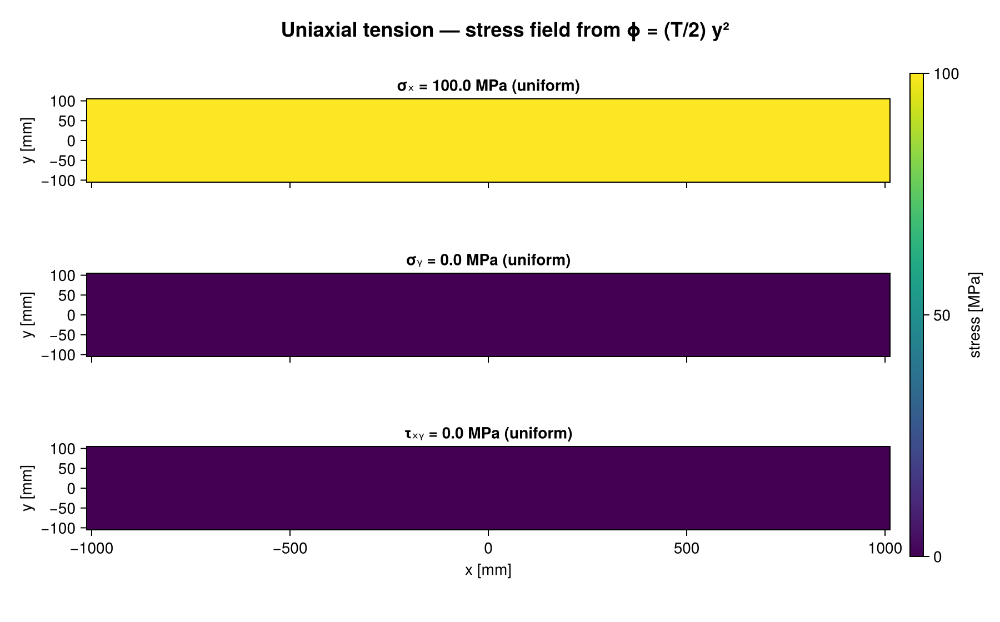
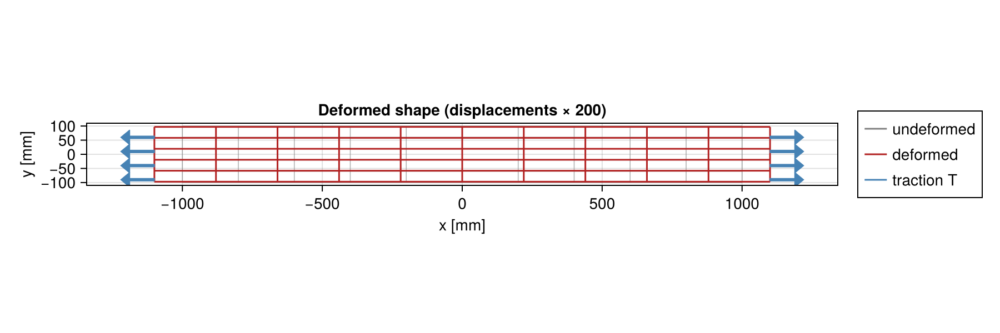

# Uniaxial tension of a beam — biharmonic (Airy stress function) solution

Sadd, *Elasticity*, Example 8-1: plane stress, rectangular beam `2l × 2c` under uniform
end tension `T`.

`uniaxial_tension_biharmonic.jl` is a [Pluto](https://plutojl.org) notebook that

1. states the plane-stress governing equation in Airy form, `∇⁴φ = 0`, and the boundary conditions (8.1.7);
2. takes the general quadratic trial function `φ = A₂₀x² + A₁₁xy + A₀₂y²`, verifies `∇⁴φ = 0` with
   `Symbolics.jl`, and solves the boundary-condition equations for the coefficients
   → `A₂₀ = A₁₁ = 0`, `A₀₂ = T/2`;
3. recovers `σx = T`, `σy = τxy = 0` and checks every boundary condition symbolically;
4. applies plane-stress Hooke's law and integrates the strain–displacement relations to get
   `u = Tx/E`, `v = −νTy/E` (rigid-body terms set to zero at the beam center);
5. evaluates the fields numerically (steel, `2l = 2000 mm`, `2c = 200 mm`, `T = 100 MPa`) and
   plots the stresses and the magnified deformed shape with `CairoMakie`.

## Running

```julia
using Pluto; Pluto.run()
```

then open `uniaxial_tension_biharmonic.jl`. Pluto installs `Symbolics` and `CairoMakie` into the
notebook's own environment on first run (a few minutes).

## Output

| `stress_field.png` | `deformed_shape.png` |
|---|---|
|  |  |
